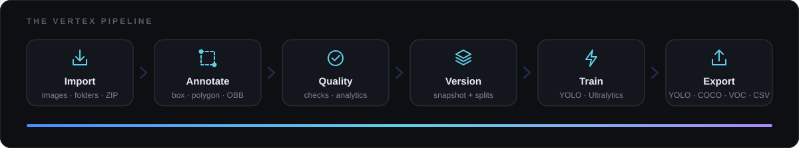
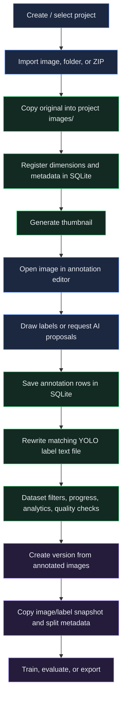
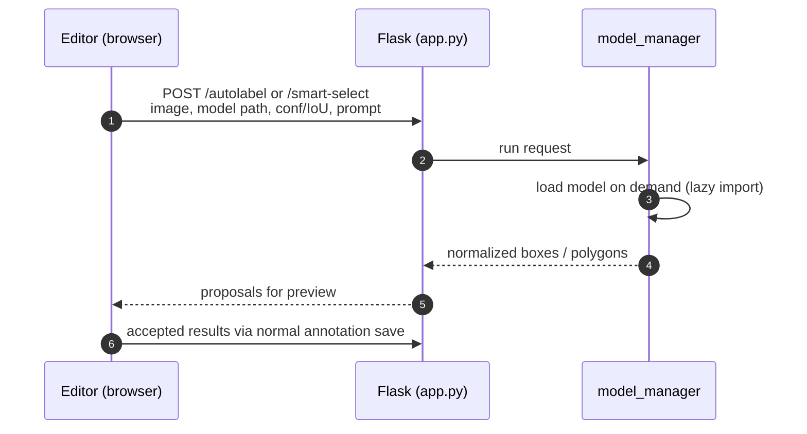
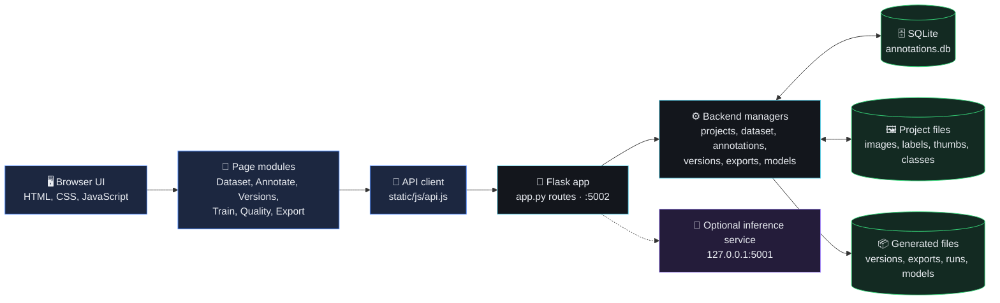
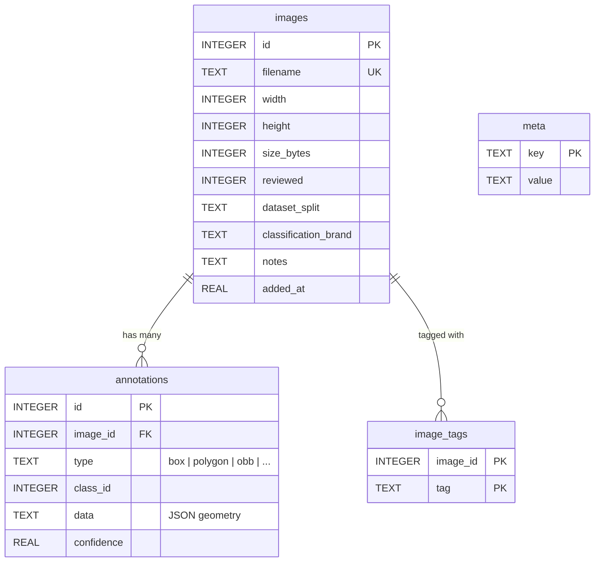
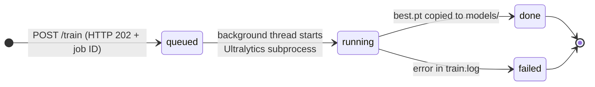

<div align="center">



<br/>


### Organize image datasets, draw and review annotations, snapshot versions, train YOLO models, and export to every common format, all on your own machine.

[**Quick start**](#-quick-start) · [**Features**](#-features) · [**How it works**](#-how-it-works) · [**Architecture**](#-architecture) · [**Training**](#-training-and-evaluation) · [**Exports**](#-export-formats) · [**API**](#-api-map)

</div>


## ✨ Why Vertex

<table>
<tr>
<td width="33%" valign="top">

### 🔒 Local-first
The web interface runs in your browser; a Flask backend stores every project on the computer running the app. Images, labels and the database never leave your machine.

</td>
<td width="33%" valign="top">

### 🧠 AI when you want it
Auto-annotate with a local Ultralytics model and segment objects with SAM smart selection. Manual annotation works without any AI packages.

</td>
<td width="33%" valign="top">

### 📦 Dataset-ready output
Reproducible version snapshots with Train/Validation/Test splits, then export to YOLO, COCO, Pascal VOC, CSV or a classification ZIP.

</td>
</tr>
</table>

## 🚀 Quick start

```bash
python -m venv .venv
.\.venv\Scripts\Activate.ps1          # Windows PowerShell
# source .venv/bin/activate           # macOS / Linux
python -m pip install --upgrade pip
python -m pip install -r requirements.txt
python app.py
```

Open **<http://localhost:5002>**. The app tries to open your browser automatically.

> [!TIP]
> For annotation only, without the AI features, install just the core packages:
> `python -m pip install Flask flask-cors numpy Pillow PyYAML opencv-python`

<details>
<summary><b>🧭 Your first project in six steps</b></summary>

<br/>

1. Create or select a project in the top bar.
2. Open **Dataset** and import images, a folder, or a ZIP.
3. Add or edit object classes in **Classes & Tags**.
4. Open an image in **Annotate** and draw labels. Use **Save** or **Save & Next** to save annotations.
5. Set image split assignments in Dataset or in the editor if you want to control Train/Validation/Test placement.
6. Create a version, then export it or start local training if the optional AI dependencies are installed.

</details>


## 🎯 Features

| | Feature | What you get |
| :-: | --- | --- |
| 🗂️ | **Projects & datasets** | Create projects; import individual images, folders, or ZIP files; search, sort, review, and delete images. |
| ✏️ | **Annotation editor** | Draw bounding boxes, polygons, and oriented bounding boxes (OBB); edit classes; undo/redo and automatic saving. |
| 🤖 | **AI assistance** *(optional)* | Object detection with a local Ultralytics model and SAM-based smart selection, when the model and packages are installed. |
| 📋 | **Annotation queue** | Separate annotated and unannotated images, review progress, and save an image before moving to the next one. |
| 🔀 | **Dataset splits** | Assign images to Train, Validation, or Test from Dataset or the editor. Images left on Auto are distributed when a version or split export is created. |
| 🧬 | **Versions & training** | Snapshot annotated images, set split ratios, add resize preprocessing, and configure augmentations. Local YOLO training and evaluation need Ultralytics and PyTorch. |
| 📊 | **Analytics & quality** | Dataset and class statistics; checks for labels, coordinates, class IDs, image integrity, duplicates, box boundaries, overlaps, and annotation counts. |
| 📤 | **Exports** | YOLO ZIPs, split YOLO ZIPs, COCO JSON, Pascal VOC ZIPs, and annotation CSV files, saved under `exports/` and downloaded through the browser. |
| 🏷️ | **Classification export** *(optional)* | Configure manual brand folders, assign verified brands and splits, and download a ZIP with `train/`, `val/`, and `test/` class folders. It does not change YOLO labels or exports. |
| 🎞️ | **More in the API** | Video frame extraction, tracking, tagging, and local inference endpoints are available in the Flask API. |

### 🖌️ Annotation tools



Smart select sends either a single click point or a dragged box to SAM, and the model returns a polygon you can review before saving.

### ⌨️ Keyboard shortcuts

| Shortcut | Action | | Shortcut | Action |
| --- | --- | --- | --- | --- |
| <kbd>B</kbd> | Box tool | | <kbd>Ctrl</kbd> + <kbd>Z</kbd> | Undo |
| <kbd>P</kbd> | Polygon tool | | <kbd>Ctrl</kbd> + <kbd>Y</kbd> | Redo |
| <kbd>N</kbd> / <kbd>→</kbd> | Next image | | <kbd>Ctrl</kbd> + <kbd>S</kbd> | Save annotations |
| <kbd>←</kbd> | Previous image | | <kbd>Delete</kbd> | Delete selected annotation |
| <kbd>R</kbd> | Mark image reviewed | | <kbd>Enter</kbd> | Finish polygon / smart selection |
| <kbd>1</kbd> – <kbd>9</kbd> | Select class by list position | | <kbd>Esc</kbd> | Cancel current drawing |


## 🔄 How it works





<details>
<summary><b>📥 Import and annotation flow</b></summary>

<br/>

1. The browser sends selected files or a local path/ZIP request to the project import API.
2. `dataset_manager` copies supported image files into the project's `images/` directory, inspects image dimensions with Pillow, inserts image records into SQLite, and creates thumbnails.
3. The Dataset page requests filtered image rows. The backend joins images to annotation rows and returns `ann_count`, review state, and split assignment for each image.
4. Opening an image asks Flask for the original image and its annotations. The canvas draws annotations using normalized image coordinates, so geometry scales with zoom and window size.
5. When an annotation changes, the page schedules an auto-save. The save endpoint replaces the image's annotation records in one database transaction, then rewrites its YOLO label file. Explicit **Save** waits for this same operation; **Save & Next** saves and advances through the unannotated queue.
6. Class IDs refer to entries in `classes.json`; class names and colors are rendered by the frontend. Statistics count annotation rows by image and class.

</details>

<details>
<summary><b>🤖 AI-assisted annotation flow</b></summary>

<br/>



1. The user selects a local model and invokes **Auto annotate** or **Smart selection**.
2. The browser sends the selected image, model path, confidence/IoU options, and any class or prompt inputs to `/api/projects/<project>/autolabel` or `/smart-select`.
3. `model_manager` loads the model on demand, runs inference, and returns normalized annotation geometry.
4. The editor previews generated annotations for review. Accepted results are saved through the normal annotation endpoint; the original image remains unchanged.

AI packages and model weights are optional for manual annotation. GPU use depends on the installed PyTorch build and hardware.

</details>

<details>
<summary><b>🔀 Split and version flow</b></summary>

<br/>

1. An image can be assigned to Train, Validation, Test, or Auto. Manual assignments are stored in the image record's `dataset_split` field.
2. Creating a version joins image rows with annotation rows, so only images with saved annotations enter the snapshot. It copies those image files and matching label files into `versions/vN/`, and copies the class list.
3. A version records the requested split ratios and an effective split per snapshot image. Manual assignments are kept; Auto images are allocated to fill the split targets.
4. Version exports use the snapshot rather than the changing project dataset. The live Dataset YOLO split export also keeps manual assignments and assigns Auto images using its ratios.

</details>

<details>
<summary><b>🩺 Quality and export flow</b></summary>

<br/>

- Quality checks read project images, labels, classes, and annotation counts. They report missing/empty labels, malformed YOLO coordinates, wrong class IDs, boxes outside image boundaries, tiny and overlapping boxes, images without annotations, high annotation counts, corrupted images, exact duplicates, and perceptual near-duplicates. **The checks report findings; they do not edit the dataset.**
- Export buttons POST the selected format and options to Flask. Backend exporters build the file or ZIP under `exports/`; Flask sends it as an attachment; the browser downloads it to its configured Downloads location.
- YOLO split export creates `images/train`, `images/val`, and `images/test` with matching label directories plus `data.yaml`. COCO produces JSON, VOC produces image/XML folders packaged as a ZIP, and CSV produces a row per supported annotation.

</details>

> [!IMPORTANT]
> **Versions are snapshots.** Later annotation edits or split changes do not rewrite an existing version. Create a new version to capture them.


## 🏗️ Architecture

Vertex is a browser-based single-page app backed by a local Flask server. The browser handles the interface and canvas drawing; Python handles project files, database operations, model work, quality checks, and dataset generation.



The main app listens on `127.0.0.1:5002`. On startup it also tries to run a small inference service on `127.0.0.1:5001`, which loads a model only when requested. Training jobs run in background threads that launch a Python subprocess, so the web request can return a job ID while training continues.

<details>
<summary><b>🖥️ Frontend</b></summary>

<br/>

| File | Role |
| --- | --- |
| `templates/index.html` | Application shell: top bar, project selector, sidebars, page host, and script loading order. |
| `static/js/app.js` | Shared browser state and page routing. The current project, selected image, image list, classes, and dataset filters live in `window.__state`. |
| `static/js/pages/*.js` | One module per screen. Pages render into the shared page host and use the global API client rather than touching SQLite or project files directly. |
| `static/js/api.js` | Wraps `fetch()` calls to Flask. JSON operations use JSON requests; export downloads arrive as binary blobs and are triggered as browser downloads. |
| `static/js/canvas.js` | Displays images and annotations; performs coordinate transforms and hit testing. |
| `static/js/tools.js` | Drawing interactions: boxes, polygons, OBBs, pan, and smart selection. |
| `static/css/style.css` | Shared layout, controls, editor, and page styles. |

</details>

<details>
<summary><b>🐍 Backend</b></summary>

<br/>

`app.py` creates the Flask application, serves `templates/index.html`, and defines the HTTP API. Route handlers parse requests and delegate work to the backend managers:

| Module | Responsibility |
| --- | --- |
| `backend/project_manager.py` | Create projects, resolve local project paths, and load/save classes and project metadata. |
| `backend/dataset_manager.py` | Import images and ZIPs, make thumbnails, query image lists and statistics, review images, and store train/validation/test assignments. |
| `backend/annotation_manager.py` | Read/write annotation rows, synchronize YOLO text labels, and provide class counts. |
| `backend/version_manager.py` | Snapshot annotated images, labels, classes, split assignments, and preprocessing metadata; package versions and create YOLO exports. |
| `backend/export_manager.py`, `coco_export.py`, `voc_export.py` | Generate YOLO, CSV, COCO JSON, and Pascal VOC artifacts. |
| `backend/classification_manager.py` | Brand folders and the optional image classification export. |
| `backend/quality_manager.py`, `advanced_stats.py` | Inspect label/image quality and calculate analytics. |
| `backend/model_manager.py` | Discover local models, run inference, auto-annotate, and provide smart selection. Heavy AI imports are lazy. |
| `backend/training_manager.py`, `eval_manager.py` | Prepare version data, launch local training jobs, report job status, and evaluate model results. |
| `backend/video_manager.py`, `video_import_manager.py`, `tracking_manager.py` | Inspect videos, extract frames, and propagate tracking annotations. |
| `backend/tag_manager.py` | Store and query image tags. |
| `backend/inference_server.py` | The optional local inference service on port 5001. |

</details>


## 🗄️ Data model and storage

Each project has an SQLite database plus ordinary files on disk. SQLite links images to annotations and stores image metadata; image bytes and dataset artifacts stay as normal files.



- **`classes.json`** stores class IDs, names, and colors. **`project.json`** stores project metadata.
- **`labels/<image-stem>.txt`** mirrors annotations in YOLO-compatible text form. Saving replaces that image's annotation rows and rewrites its label file. If an image has no database annotations, the annotation manager can import existing YOLO text labels into SQLite.
- **`thumbs/`** holds cached JPEG thumbnails. A missing thumbnail is regenerated from the original on request.
- Deleting an image cascades to its annotation rows.

> [!NOTE]
> The SQLite database is the primary index for filtering, statistics, and annotation state. The original image under `images/` is never changed by drawing or preprocessing.

```text
projects/<project-name>/
├── images/           # original image files
├── labels/           # YOLO-compatible per-image label files
├── thumbs/           # generated thumbnails
├── versions/         # version snapshots and metadata
├── annotations.db    # SQLite project and annotation data
├── classes.json      # class names and colors
└── project.json      # project metadata

exports/              # generated downloads and export artifacts
models/               # local model weights and trained model files
runs/                 # training datasets, logs, and evaluation reports
```

> [!TIP]
> **Backups:** copy the project directory to keep its images, labels, classes, and annotations. Back up `models/` and `runs/` separately if you need trained weights and training history.


## 🏋️ Training and evaluation

Training uses a **version snapshot**, so first create a version from the annotated images you want to train on. The version holds the image files, YOLO label files, class names, and split metadata.



| Setting | Default | Meaning |
| --- | --- | --- |
| `version_id` | **Required** | Version number to train from, such as `1` for `v1`. |
| `base_model` | `yolo11n.pt` | Ultralytics checkpoint name or a model file path readable by the server. Ultralytics may download a named checkpoint on first use. |
| `epochs` | `100` | Number of complete passes over the training data. |
| `imgsz` | `640` | Image size used by YOLO during training. |
| `batch` | `16` | Batch size; reduce it if memory runs out. |
| `device` | Automatic | Optional Ultralytics device selector, for example `cpu`, `0`, or `0,1`. |
| `split` | `true` | Prepare train, validation, and test folders for the run. |

<details>
<summary><b>📡 Calling the training API directly</b></summary>

<br/>

`POST /api/projects/<project>/train` with JSON like this:

```json
{
  "version_id": 1,
  "base_model": "yolo11n.pt",
  "epochs": 100,
  "imgsz": 640,
  "batch": 16,
  "device": "",
  "split": true
}
```

The server checks that the version exists, prepares a temporary dataset and `data.yaml` under `runs/`, and returns a job ID with HTTP `202`. Poll `GET /api/jobs/<job_id>` for the state (`queued`, `running`, `done`, or `failed`) and the latest log lines; `GET /api/jobs` lists the jobs known to the running server process.

</details>

**What a run produces**

- A run folder at `runs/<project>_v<version>_<job-id>/` with `train.log`, the prepared dataset, and Ultralytics training artifacts.
- When Ultralytics produces `best.pt`, it is copied to `models/<project>_v<version>_<job-id>.pt`.
- The Train page shows the settings above, lists jobs, polls the active job for status and logs, and displays saved model paths and evaluation metrics.

**Evaluation** is available at `POST /api/projects/<project>/eval`. Provide `version_id`, `model_path`, and optionally `split` (`val` by default), `imgsz`, `conf`, and `iou`. It runs Ultralytics validation and saves a JSON report under `runs/` with mAP50, mAP50-95, precision, recall, and per-class metrics when available.

> [!WARNING]
> - The job registry is held in memory, so the job list resets when the Flask server restarts. Run logs and model files stay on disk.
> - Augmentation and preprocessing settings saved on a version are **not** currently passed to the Ultralytics training call.
> - Version split assignments are reused for training. If an older version has no per-image split map, the trainer fills the missing assignments deterministically from that version's split ratios.


## 📤 Export formats

Open **Export**, pick a format, then click **Download format**. The *annotated only* option is on by default.

| Format | Contents |
| --- | --- |
| 🟦 **YOLO Detection ZIP** | Images, YOLO label files, class names, and `data.yaml`. |
| 🟦 **YOLO split ZIP** | Train/validation/test folders. Saved per-image splits are kept; Auto images are assigned using the export ratios. |
| 🟨 **COCO JSON** | Image metadata plus box, polygon, and oriented-box annotations. |
| 🟩 **Pascal VOC ZIP** | Images, XML bounding-box annotations, and `ImageSets/Main/trainval.txt`. |
| 🟪 **CSV** | One row per saved box, polygon, or oriented-box annotation. |
| 🟥 **Classification ZIP** | `train/`, `val/`, `test/` class folders from verified brand assignments. Available from Export or the version Download dialog. |

The browser saves downloads to its configured location, and the app also writes each export under `exports/`.


## 🔌 API map

| Route pattern | Purpose |
| --- | --- |
| `/api/projects` | List or create projects. |
| `/api/projects/<name>/images` | List/filter images; `/import` registers imported media. |
| `/api/projects/<name>/annotations/<filename>` | Get or replace annotations for one image. |
| `/api/projects/<name>/classes` | Read or save project classes. |
| `/api/projects/<name>/dataset-split` | Assign one image to Train, Validation, Test, or Auto. |
| `/api/projects/<name>/versions` | List or create snapshots. Version routes also download, export, or delete snapshots. |
| `/api/projects/<name>/export/<format>` | Download live-project exports. |
| `/api/projects/<name>/quality` | Run dataset quality checks. |
| `/api/projects/<name>/autolabel`, `/smart-select` | Run optional AI-assisted annotation. |
| `/api/projects/<name>/train`, `/eval` | Start training or evaluate a model. |
| `/api/jobs`, `/api/jobs/<job_id>` | Inspect local training jobs. |
| `/api/jobs/<job_id>/stop`, `/download` | Stop a running job or download its output. |

The complete route definitions are in [`app.py`](app.py).


## 🧰 Requirements and installation

- **Python 3.10** or newer
- A modern browser
- The packages in [`requirements.txt`](requirements.txt)

| Package | Used for |
| --- | --- |
| `Flask`, `flask-cors`, `Werkzeug` | Web server and HTTP API |
| `numpy`, `Pillow`, `opencv-python` | Image loading, thumbnails, video frames, quality checks |
| `PyYAML` | `data.yaml` for YOLO datasets and training |
| `ultralytics` *(pulls in PyTorch)* | Auto-annotate, SAM smart select, tracking, training, evaluation |

> [!IMPORTANT]
> **GPU training:** Ultralytics installs a compatible PyTorch for many setups, but for NVIDIA GPU support install the PyTorch build that matches your CUDA version **first**, using the [official PyTorch selector](https://pytorch.org/get-started/locally/), then run `pip install -r requirements.txt`. Place local weights in `models/` or select an available model in the app.

Stop the server with <kbd>Ctrl</kbd> + <kbd>C</kbd>. Debug auto-reload is off, so restart the server after changing Python backend code.

<details>
<summary><b>🛠️ Troubleshooting</b></summary>

<br/>

| Symptom | Fix |
| --- | --- |
| Training runs on CPU although you have an NVIDIA GPU | Reinstall PyTorch with the CUDA build from the PyTorch selector, then restart the app. |
| Training fails with an out-of-memory error | Lower `batch` (and, if needed, `imgsz`). |
| Backend changes have no effect | Restart `python app.py`; auto-reload is disabled. |
| OpenCV import errors | Keep a single OpenCV package installed (`opencv-python`); `opencv-python-headless` and `opencv-contrib-python` alongside it can conflict. |
| A training job disappeared from the list | The job registry is in memory and resets on restart; check `runs/` and `models/`. |
| A named model downloads on first use | Expected: Ultralytics fetches named checkpoints. Put weights in `models/` for offline use. |

</details>

## 📁 Project layout

```text
app.py                 # Flask routes and application startup
backend/               # dataset, annotation, version, model, export, and analytics logic
static/css/            # application styles
static/js/             # frontend shell, API client, canvas, tools, and pages
templates/index.html   # single-page application entry point
docs/assets/           # animated README graphics
projects/              # local project data (created at runtime)
exports/               # generated export artifacts
models/                # local model weights
runs/                  # training and evaluation output
requirements.txt       # Python dependencies
```

## 📝 Notes

- Core annotation and dataset management run fully offline. Optional AI features need their packages and model weights; downloading those requires internet access.
- Training and inference speed depend on the installed PyTorch build and your CPU/GPU.
- Dataset versions are snapshots: create a new version to capture newer annotations or split assignments.

<div align="center">


<sub>Built with Flask, SQLite and Ultralytics · Runs entirely on your machine</sub>

</div>
