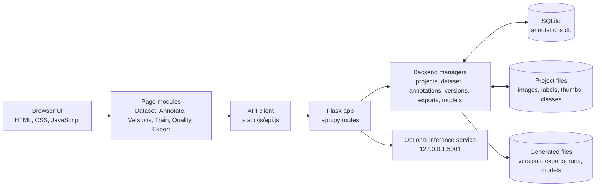
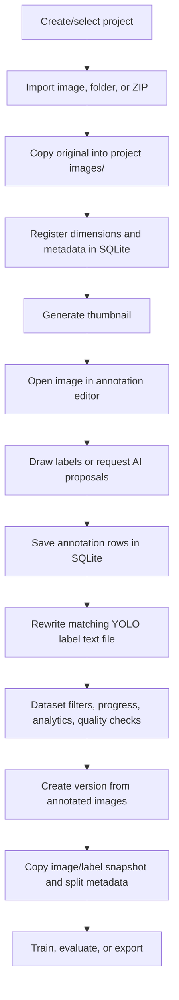

# Vertex — Local Image Annotation Workstation

Vertex is a local web app for organizing image datasets, drawing and reviewing annotations, creating train/validation/test versions, and exporting datasets. The web interface runs in your browser; the Flask backend stores project data on the computer running the app.

## Features

- **Projects and datasets:** create projects; import individual images, folders, or ZIP files; search, sort, review, and delete images.
- **Annotation editor:** draw bounding boxes, polygons, and oriented bounding boxes (OBB); edit classes; use undo/redo and automatic saving.
- **AI assistance (optional):** run object detection with a local Ultralytics model and use SAM-based smart selection when the required model and packages are installed.
- **Annotation queue:** separate annotated and unannotated images, review progress, and save an image before moving to the next one.
- **Dataset splits:** assign images to Train, Validation, or Test from Dataset or the editor. Automatic assignments are distributed when a version or split export is created.
- **Versions and training:** create snapshots from annotated images, set split ratios, add resize preprocessing, and configure augmentations. Local YOLO training and evaluation require Ultralytics and PyTorch.
- **Analytics and quality checks:** view dataset and class statistics; check labels, coordinates, class IDs, image integrity, duplicates, box boundaries, overlaps, and annotation counts.
- **Exports:** download YOLO ZIPs, split YOLO ZIPs, COCO JSON, Pascal VOC ZIPs, and annotation CSV files. Exports can be saved in the app's `exports/` directory and downloaded through the browser.
- **Additional backend capabilities:** video frame extraction, tracking, tagging, and local inference endpoints are available in the Flask API.

## Architecture

Vertex is a browser-based single-page app backed by a local Flask server. The browser handles the interface and canvas drawing; Python handles project files, database operations, model work, quality checks, and dataset generation.



### Frontend

- `templates/index.html` provides the application shell: top bar, project selector, sidebars, page host, and script loading order.
- `static/js/app.js` owns shared browser state and routes between pages. The current project, selected image, image list, classes, and dataset filters are held in `window.__state`.
- `static/js/pages/*.js` implements each screen. A page renders into the shared page host and uses the global API client rather than accessing SQLite or project files directly.
- `static/js/api.js` wraps `fetch()` calls to Flask endpoints. JSON operations use JSON requests; export downloads are received as binary blobs and triggered as browser downloads.
- `static/js/canvas.js` displays images and annotations and performs coordinate transforms and hit testing. `static/js/tools.js` implements drawing interactions such as boxes, polygons, OBBs, pan, and smart selection.
- `static/css/style.css` contains the shared layout, controls, editor, and page styles.

### Backend

`app.py` creates the Flask application, serves `templates/index.html`, and defines the HTTP API. Route handlers parse requests and delegate work to the backend managers:

| Module | Responsibility |
| --- | --- |
| `backend/project_manager.py` | Create projects, resolve local project paths, and load/save classes and project metadata. |
| `backend/dataset_manager.py` | Import images and ZIPs, make thumbnails, query image lists and statistics, review images, and store train/validation/test assignments. |
| `backend/annotation_manager.py` | Read/write annotation rows, synchronize YOLO text labels, and provide class counts. |
| `backend/version_manager.py` | Snapshot annotated images, labels, classes, split assignments, and preprocessing metadata; package versions and create YOLO exports. |
| `backend/export_manager.py`, `coco_export.py`, `voc_export.py` | Generate YOLO, CSV, COCO JSON, and Pascal VOC artifacts. |
| `backend/quality_manager.py`, `advanced_stats.py` | Inspect label/image quality and calculate analytics. |
| `backend/model_manager.py` | Discover local models, run inference, auto-annotate, and provide smart selection. Imports of heavyweight AI packages are lazy. |
| `backend/training_manager.py`, `eval_manager.py` | Prepare version data, launch local training jobs, report job status, and evaluate model results. |
| `backend/video_manager.py`, `tracking_manager.py` | Inspect videos, extract frames, and propagate tracking annotations. |
| `backend/tag_manager.py` | Store and query image tags. |

The main app listens on `127.0.0.1:5000`. On startup it also attempts to run a small inference service on `127.0.0.1:5001`; that service loads a model only when requested. Training jobs run in background threads and launch a Python subprocess, so the web request can return a job ID while training continues.

## Data model and storage

Each project has an SQLite database plus files on disk. SQLite links images to annotations and stores image metadata; image bytes and dataset artifacts remain ordinary files.

- The `images` table stores the filename, dimensions, file size, review state, optional dataset split, and import time.
- The `annotations` table stores image ID, annotation type, class ID, confidence, and a JSON payload with the geometry. An image can have many annotation rows.
- The `meta` table is available for project-scoped key/value metadata.
- `classes.json` stores class IDs, names, and colors. `project.json` stores project metadata.
- `labels/<image-stem>.txt` mirrors annotations in YOLO-compatible text form. Saving annotations replaces that image's annotation rows and rewrites its text label file. When an annotation request finds no database annotations, the annotation manager can import existing YOLO text labels into SQLite.
- `thumbs/` contains cached JPEG thumbnails. If a thumbnail is missing, the thumbnail route attempts to regenerate it from the original.

The SQLite database is the primary index for filtering, statistics, and annotation state. The original image under `images/` is not changed by drawing or preprocessing.

## End-to-end data pipeline



### Import and annotation flow

1. The browser sends selected files or a local path/ZIP request to the project import API.
2. `dataset_manager` copies supported image files into the project's `images/` directory, inspects image dimensions with Pillow, inserts image records into SQLite, and creates thumbnails.
3. The Dataset page requests filtered image rows. The backend joins images to annotation rows and returns `ann_count`, review state, and split assignment for each image.
4. Opening an image asks Flask for the original image and its annotations. The canvas draws annotations using normalized image coordinates, so geometry scales with zoom and window size.
5. When an annotation changes, the page schedules an auto-save. The save endpoint replaces the image's annotation records in one database transaction, then rewrites its YOLO label file. Explicit **Save** waits for this same operation; **Save & Next** saves and advances through the unannotated queue.
6. Class IDs refer to entries in `classes.json`; class names and colors are rendered by the frontend. Statistics count annotation rows by image and class.

### AI-assisted annotation flow

1. The user selects a local model and invokes Auto annotate or Smart selection.
2. The browser sends the selected image, model path, confidence/IoU options, and any class or prompt inputs to `/api/projects/<project>/autolabel` or `/smart-select`.
3. `model_manager` loads the model on demand, runs inference, and returns normalized annotation geometry.
4. The editor can preview generated annotations for review. Accepted results are saved through the normal annotation endpoint; the original image remains unchanged.

AI packages and model weights are optional for ordinary manual annotation. GPU use depends on the installed PyTorch build and hardware.

### Split and version flow

1. An image can be assigned to Train, Validation, Test, or Auto. Manual assignments are stored in the image record's `dataset_split` field.
2. Creating a version joins image rows with annotation rows, so only images with saved annotations enter the snapshot. It copies those image files and matching label files into `versions/vN/`, and copies the class list.
3. A version records the requested split ratios and an effective split per snapshot image. Manual assignments are retained; Auto images are allocated to fill the split targets.
4. Version exports use the snapshot rather than the changing project dataset. The live Dataset YOLO split export also keeps manual assignments and assigns Auto images using its ratios.

Versions are snapshots: later annotation edits or split changes do not rewrite an existing version. Create a new version to capture changes.

### Training and evaluation flow

1. The user starts training from a selected version and chooses a base model and training settings.
2. `training_manager` creates a temporary dataset directory and `data.yaml` under `runs/`, then launches the Ultralytics training command in a subprocess.
3. The job ID is returned to the UI. Job status and recent log lines are exposed through the jobs API.
4. On completion, the best model is copied into `models/`; logs and run artifacts remain under `runs/`.
5. Evaluation loads a selected model and version, validates against the requested split, and writes a JSON report under `runs/`.

These steps require Ultralytics and PyTorch; manually creating, viewing, and exporting annotations does not.

### Quality and export flow

- Quality checks read project images, labels, classes, and annotation counts. They report missing/empty labels, malformed YOLO coordinates, wrong class IDs, boxes outside image boundaries, tiny and overlapping boxes, images without annotations, high annotation counts, corrupted images, exact duplicates, and perceptual near-duplicates. The checks report findings; they do not edit the dataset.
- Export buttons POST the selected format and options to Flask. Backend exporters build the file or ZIP under `exports/`; Flask sends it as an attachment; the browser downloads it to its configured Downloads location.
- YOLO split export creates `images/train`, `images/val`, and `images/test` and matching label directories plus `data.yaml`. COCO produces JSON, VOC produces image/XML folders packaged as a ZIP, and CSV produces a row per supported annotation.

## API map

The main routes are grouped by project and operation:

| Route pattern | Purpose |
| --- | --- |
| `/api/projects` | List or create projects. |
| `/api/projects/<name>/images` | List/filter images; `/import` registers imported media. |
| `/api/projects/<name>/annotations/<filename>` | Get or replace annotations for one image. |
| `/api/projects/<name>/classes` | Read or save project classes. |
| `/api/projects/<name>/dataset-split` | Assign one image to Train, Validation, Test, or Auto. |
| `/api/projects/<name>/versions` | List or create snapshots. Version routes also download, export, or delete snapshots. |
| `/api/projects/<name>/export/<format>` | Download live-project exports. |
| `/api/projects/<name>/quality` | Run dataset quality checks. |
| `/api/projects/<name>/autolabel` and `/smart-select` | Run optional AI-assisted annotation. |
| `/api/projects/<name>/train`, `/api/jobs` | Start and inspect local training jobs. |

The complete route definitions and request handling are in `app.py`.

## Requirements

- Python 3.10 or newer
- The Python packages below
- A modern browser

There is currently no `requirements.txt` file. Install the app's core dependencies directly:

```powershell
python -m venv .venv
.\.venv\Scripts\Activate.ps1
python -m pip install --upgrade pip
python -m pip install Flask flask-cors numpy Pillow PyYAML opencv-python
```

On macOS or Linux, activate the environment with:

```bash
python3 -m venv .venv
source .venv/bin/activate
python -m pip install --upgrade pip
python -m pip install Flask flask-cors numpy Pillow PyYAML opencv-python
```

### Optional AI and training packages

Install Ultralytics and PyTorch to use local detection models, SAM-based tools, training, and evaluation:

```bash
python -m pip install ultralytics
```

Ultralytics installs a compatible PyTorch dependency for many setups. For NVIDIA GPU support, install the PyTorch build that matches your CUDA environment using the [official PyTorch install selector](https://pytorch.org/get-started/locally/). Model weights may need to be downloaded separately; place local weights in `models/` or select an available model in the app.

## Start the app

From the project directory, activate the virtual environment and run:

```bash
python app.py
```

Open [http://localhost:5000](http://localhost:5000). The app attempts to open a browser automatically. The optional local inference service uses `127.0.0.1:5001`.

Stop the server with **Ctrl+C** in the terminal. The Flask server runs with debug auto-reload disabled, so restart it after changing Python backend code.

## First steps

1. Create or select a project in the top bar.
2. Open **Dataset** and import images, a folder, or a ZIP.
3. Add or edit object classes in **Classes & Tags**.
4. Open an image in **Annotate** and draw labels. Use **Save** or **Save & Next** to save annotations.
5. Set image split assignments in Dataset or in the editor if you want to control Train/Validation/Test placement.
6. Create a version, then export it or start local training if the optional AI dependencies are installed.

## Annotation shortcuts

| Shortcut | Action |
| --- | --- |
| `B` | Select box tool |
| `P` | Select polygon tool |
| `N` or `→` | Next image |
| `←` | Previous image |
| `R` | Mark image reviewed |
| `1`–`9` | Select a class by its position in the class list |
| `Ctrl+Z` | Undo |
| `Ctrl+Y` | Redo |
| `Ctrl+S` | Save annotations |
| `Delete` | Delete the selected annotation |
| `Enter` | Finish polygon/smart selection where supported |
| `Esc` | Cancel the current drawing where supported |

## Export formats

Open **Export**, select a format, then click **Download format**. The annotated-only option is enabled by default.

- **YOLO Detection ZIP:** images, YOLO label files, class names, and `data.yaml`.
- **YOLO split ZIP:** train/validation/test folders. Saved per-image split assignments are kept; images set to Auto are assigned using the configured export ratios.
- **COCO JSON:** image metadata and box, polygon, and oriented-box annotations.
- **Pascal VOC ZIP:** images, XML bounding-box annotations, and `ImageSets/Main/trainval.txt`.
- **CSV:** one row per saved box, polygon, or oriented-box annotation.

The browser saves downloads to its configured download location. The app also writes generated export artifacts under `exports/` in the project directory.

## Data storage

Project data is stored locally under `projects/<project-name>/`:

```text
projects/<project-name>/
├── images/           # original image files
├── labels/           # YOLO-compatible per-image label files
├── thumbs/           # generated thumbnails
├── versions/         # version snapshots and metadata
├── annotations.db    # SQLite project and annotation data
├── classes.json      # class names and colors
└── project.json      # project metadata
```

Other generated files are stored in:

```text
exports/              # generated downloads and export artifacts
models/               # local model weights and trained model files
runs/                 # training datasets, logs, and evaluation reports
```

Back up the relevant project directory to preserve its images, labels, classes, and annotations. Back up `models/` and `runs/` separately if you need trained weights and training history.

## Project layout

```text
app.py                # Flask routes and application startup
backend/              # dataset, annotation, version, model, export, and analytics logic
static/css/            # application styles
static/js/             # frontend shell, API client, canvas, tools, and pages
templates/index.html   # single-page application entry point
projects/              # local project data (created at runtime)
exports/               # generated export artifacts
models/                # local model weights
runs/                  # training and evaluation output
```

## Notes

- Core image annotation and dataset management run locally. Optional AI features need their Python packages and model weights; downloading packages or weights requires internet access.
- AI training and inference performance depends on the installed PyTorch build and available CPU/GPU hardware.
- Dataset versions are snapshots. Changes made after creating a version do not modify that version; create a new version to capture newer annotations or split assignments.
